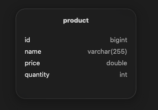
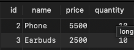
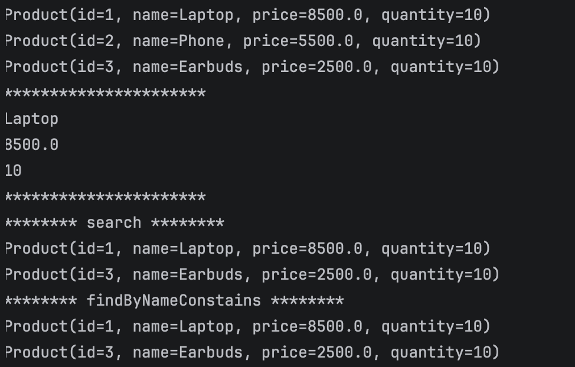

# ORM, JPA, Hibernate et Spring Data

Application Spring Boot qui illustre la persistance des données avec **JPA**, **Hibernate** et **Spring Data JPA**, puis la migration d'une base **H2** en mémoire vers un serveur **MySQL**.

Ce projet m'a permis de comprendre comment un objet Java devient une ligne en base de données, sans écrire une seule requête SQL de création de table.

---

## Objectifs du TP

1. Mapper une classe Java vers une table grâce à JPA
2. Utiliser Spring Data JPA pour réaliser les opérations CRUD
3. Écrire des requêtes personnalisées avec `@Query` et des méthodes dérivées
4. Migrer de H2 vers MySQL sans modifier le code métier
5. Sécuriser les identifiants de connexion avec des variables d'environnement

---

## Technologies utilisées

| Technologie | Rôle |
|---|---|
| Java 25 | Langage |
| Spring Boot 4 | Framework principal |
| Spring Data JPA | Accès aux données |
| Hibernate | Implémentation de JPA (ORM) |
| H2 | Base en mémoire pour la phase de test |
| MySQL 8 | Base de données finale |
| DBngin | Lancement du serveur MySQL sur Mac |
| TablePlus | Client graphique pour consulter la base |
| IntelliJ IDEA | Environnement de développement |

---

## Structure du projet

```
src/main/java/net/anwar/ormjpahibernatespringdata
    OrmJpaHibernateSpringDataApplication.java
    entities
        Product.java
    repository
        ProductRepository.java
src/main/resources
    application.properties
```

Le projet suit une séparation simple : les **entités** décrivent les données, le **repository** y donne accès, et la classe principale exécute les scénarios de test grâce à un `CommandLineRunner`.

---

## L'entité Product

Chaque produit possède un identifiant généré automatiquement, un nom, un prix et une quantité.

```java
@Entity
@Data
@NoArgsConstructor
@AllArgsConstructor
public class Product {
    @Id
    @GeneratedValue(strategy = GenerationType.IDENTITY)
    private Long id;
    private String name;
    private double price;
    private int quantity;
}
```

Au démarrage, Hibernate lit cette classe et crée la table `product` dans la base.

---

## Le repository

`ProductRepository` hérite de `JpaRepository`, ce qui donne sans code supplémentaire les méthodes `save`, `findById`, `findAll` et `deleteById`.

Deux recherches personnalisées sont ajoutées :

```java
public interface ProductRepository extends JpaRepository<Product, Long> {

    // Requête JPQL écrite à la main
    @Query("select p from Product p where p.name like :x")
    List<Product> search(@Param("x") String keyword);

    // Requête générée automatiquement à partir du nom de la méthode
    List<Product> findByNameContains(String keyword);
}
```

La méthode `findByNameContains` n'a besoin d'aucune implémentation : Spring Data déduit la requête à partir de son nom.

---

## Opérations réalisées

### 1. Création

```java
productRepository.save(new Product(null, "Laptop", 8500, 10));
```

Quand l'identifiant vaut `null`, `save` produit un `INSERT`.

### 2. Lecture

```java
List<Product> products = productRepository.findAll();
Product product = productRepository.findById(1L).get();
```

### 3. Recherche

```java
productRepository.search("%a%");
productRepository.findByNameContains("a");
```

### 4. Mise à jour

```java
productRepository.findById(1L).ifPresent(p -> {
    p.setName("Laptop Gaming");
    p.setPrice(9500);
    productRepository.save(p);
});
```

Ici l'identifiant existe déjà, donc `save` produit un `UPDATE`.

### 5. Suppression

```java
productRepository.deleteById(1L);
```

---

## Mise à jour : pourquoi cette approche

J'ai comparé deux façons de modifier un produit existant.

| Approche | Quand l'utiliser |
|---|---|
| `findById` puis setters puis `save` | Modifier un produit, cas standard |
| `@Modifying` avec `@Query` | Modification en masse ou requête imposée |

L'approche `findById` reste la plus sûre : Hibernate gère son cache, le verrouillage optimiste et les validations. L'annotation `@Modifying` exécute la requête directement en base et peut laisser des valeurs périmées dans le cache de Hibernate, d'où les options `flushAutomatically` et `clearAutomatically`.

---

## Migration de H2 vers MySQL

### Pourquoi migrer

H2 efface les données à chaque arrêt de l'application. MySQL conserve les données et se rapproche d'un environnement réel.

### Étape 1 : remplacer la dépendance

```xml
<dependency>
    <groupId>com.mysql</groupId>
    <artifactId>mysql-connector-j</artifactId>
    <scope>runtime</scope>
</dependency>
```

### Étape 2 : démarrer le serveur MySQL

Le serveur est lancé avec DBngin sur le port 3306, puis la base est créée :

```sql
CREATE DATABASE products_db;
```

### Étape 3 : configurer la connexion

```properties
spring.datasource.url=jdbc:mysql://localhost:3306/products_db
spring.datasource.username=${DB_USER:root}
spring.datasource.password=${DB_PASSWORD:}
spring.jpa.hibernate.ddl-auto=update
spring.jpa.show-sql=true
```

Le code Java n'a pas changé. C'est tout l'intérêt de JPA : l'application ne dépend pas du type de base utilisé.

---

## Sécurité des identifiants

Le mot de passe n'est jamais écrit en clair dans le dépôt. Il est lu depuis des variables d'environnement grâce à la syntaxe `${NOM:valeur par défaut}`.

Dans IntelliJ, les variables se définissent ici :

**Run, Edit Configurations, Modify options, Environment variables**

```
DB_USER=root;DB_PASSWORD=votre_mot_de_passe
```

Ainsi, aucune information sensible n'apparaît dans le code partagé.

---

## Lancer le projet

1. Cloner le dépôt
2. Démarrer MySQL et créer la base `products_db`
3. Définir les variables `DB_USER` et `DB_PASSWORD`
4. Lancer la classe `OrmJpaHibernateSpringDataApplication`

---

## Captures d'écran


### Table product générée par Hibernate



### Données insérées par le CommandLineRunner



### Sortie console avec les requêtes SQL




---

## Ce que j'ai appris

1. Le rôle d'un ORM : faire le lien entre objets Java et tables relationnelles
2. La différence entre JPA (la spécification) et Hibernate (l'implémentation)
3. Le fonctionnement de `save`, qui insère ou met à jour selon l'identifiant
4. Les requêtes dérivées du nom de méthode et les requêtes JPQL
5. Le cache de premier niveau d'Hibernate et ses effets sur `@Modifying`
6. La migration d'une base à une autre uniquement par la configuration
7. La protection des données sensibles avec les variables d'environnement

---

## Auteur

**Anwar**
Étudiant en développement, réalisé dans le cadre d'un travail pratique sur la persistance des données avec Spring.